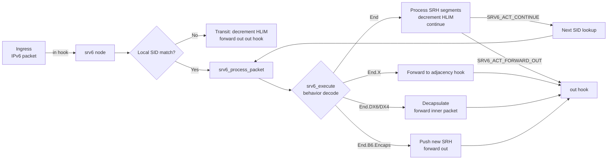

# SRv6 netgraph node

SRv6 (Segment Routing over IPv6) implemented as an out-of-tree FreeBSD kernel
module. It is a netgraph node type named `srv6` that processes IPv6 packets
carrying a Segment Routing Header (SRH) per [RFC 8754](doc/rfc8754.txt), and
implements the SRv6 endpoint behaviors defined in [RFC 8986](doc/rfc8986.txt)
with [RFC 9602](doc/rfc9602.txt) SID addressing and
[RFC 9800](doc/rfc9800.txt) compressed SID (CSID) flavors.

## Build

```sh
make                    # builds ./srv6.ko
make -C tests           # builds tests/module/test_srv6.ko
```

- Override `SYSDIR=/path/to/sys` if the kernel source is not at `/usr/src/sys`.
- `-Werror` is enabled; mark unused parameters `__unused`.
- Building works unprivileged. Do not load or unload the module.
- There is no test runner. Minimum verification is `make` and
  `make -C tests`. Do not attempt runtime validation by loading.

## Netgraph API

The node type is registered as `NG_SRV6_NODE_TYPE` (`"srv6"`).

### Hooks

- `"in"` (`NG_SRV6_HOOK_IN`): default ingress hook. IPv6 packets received
  here are parsed and processed through the SRv6 data path.
- `"out"` (`NG_SRV6_HOOK_OUT`): default egress hook. Packets that resolve to
  `SRV6_ACT_FORWARD_OUT` are sent out this hook.
- Additional hooks may be created and named in adjacency entries; they are
  used by `End.X` and `End.DX*` behaviors to forward to a specific next hook.

The `srv6` node does not attach directly to a physical interface.  Hooks are
wired up through netgraph: connect an `ng_ether` node (bound to a physical NIC)
to the `srv6` node's `"in"` and `"out"` hooks so packets flow in and out of the
SRv6 data path.  See the "Connecting to a physical interface" section below.

### Control messages (`ngctl`)

All messages use cookie `NG_SRV6_COOKIE` (`0x53525636`, `"SRV6"`).

| Command | `ngctl` name | Argument | Response | Description |
|---------|--------------|----------|----------|-------------|
| `NGM_SRV6_ADD_SID` | `addsid` | `srv6_sid_config` | — | Add or replace a local SID |
| `NGM_SRV6_DEL_SID` | `delsid` | IPv6 address | — | Remove a local SID |
| `NGM_SRV6_ADD_ADJ` | `addadj` | `srv6_adj_config` | — | Add or replace an L3 adjacency |
| `NGM_SRV6_DEL_ADJ` | `deladj` | `uint32` (index) | — | Remove an adjacency |
| `NGM_SRV6_SET_SRC` | `setsrc` | IPv6 address | — | Set default encapsulation source |
| `NGM_SRV6_GET_STATS` | `getstats` | — | `srv6_stats` | Get node statistics |
| `NGM_SRV6_GET_SID` | `getsid` | IPv6 address | `srv6_sid_info` | Get one local SID |
| `NGM_SRV6_GET_ADJ` | `getadj` | `uint32` (index) | `srv6_adj_info` | Get one adjacency |
| `NGM_SRV6_CLR_STATS` | `clrstats` | — | — | Clear all statistics |

### Data structures

Defined in `srv6.h`:

- `struct srv6_sid_config` — local SID configuration (address, IANA behavior
  codepoint, CSID layout lengths, adjacency index, FIB tables, segment list,
  source address).
- `struct srv6_adj_config` — L3 adjacency (nexthop, index, FIB table, hook
  name).
- `struct srv6_stats` — node counters (`packets_in`, `packets_out`,
  `packets_dropped`, `bytes_in`, `errors`, `sids`, `adjs`).
- `struct srv6_sid_info` / `struct srv6_adj_info` — per-SID/per-adjacency
  counters returned by `GET_SID`/`GET_ADJ`.

### Behavior support

IANA endpoint behavior codepoints (from RFC 8986 Section 10.2 and RFC 9800
Section 12.1) are decoded in `srv6_behavior_decode()`. The base behaviors
implemented are:

- `End` (codepoint 1)
- `End.X` (codepoint 5)
- `End.T` (codepoint 9)
- `End.B6.Encaps` (codepoint 14)
- `End.BM` (codepoint 15)
- `End.DX6` (codepoint 16)
- `End.DX4` (codepoint 17)
- `End.DT6` (codepoint 18)
- `End.DT4` (codepoint 19)
- `End.DT46` (codepoint 20)
- `End.DX2` (codepoint 21)
- `End.DX2V` (codepoint 22)
- `End.DT2U` (codepoint 23)
- `End.DT2M` (codepoint 24)
- `End.B6.Encaps.Red` (codepoint 27)

Flavor bits (`PSP`, `USP`, `USD`, `NEXT-CSID`, `REPLACE-CSID`) are decoded
from the codepoint as described in RFC 8986 and RFC 9800. See
`srv6_behavior_decode()` for the full mapping.

### Known gaps / limitations

- Transit packets are dropped unless a matching local SID is found.
- `srv6_parse_srh()` and `srv6_encapsulate()` are defined but not fully
  integrated into the data path.
- `srv6_cmdlist[]` exists but the `NGM_SRV6_*` handlers are partially
  implemented; SIDs and adjacencies can be added/removed via `ngctl`.
- `srv6_ng_newhook()` accepts any hook name; `"out"` and `"ctl"` are not
  fully wired up to separate pipelines.
- `End.BM`, `End.LBS`, `End.XLBS`, `End.DX2V`, `End.DT2U`, `End.DT2M` return
  `EOPNOTSUPP`.

## Usage

The node is a netgraph type named `srv6`. Create a node, add hooks, and
configure SIDs and adjacencies with `ngctl`. **Build and inspect only — do not
load the kernel module** unless you are certain it is safe.

### Connecting to a physical interface

The `srv6` node is a pure netgraph node: it does not own a network interface
directly.  To attach it to a physical NIC, use `ng_ether` as a bridge between
the NIC and the `srv6` node's `"in"` and `"out"` hooks.

Example (replace `em0` with your interface name):

```sh
# 1. Create an ng_ether node bound to the physical NIC
ngctl mkpeer . ether ether/em0

# 2. Create the srv6 node
ngctl mkpeer . srv6 srv6_r1

# 3. Connect the NIC's upper hook to srv6's "in" hook (ingress)
ngctl connect em0: srv6_r1: upper in

# 4. Connect srv6's "out" hook back to the NIC's upper hook (egress)
ngctl connect srv6_r1: em0: out upper
```

Additional named hooks for adjacencies can be connected similarly; the hook
name is stored in the adjacency config via `addadj` and used by
`srv6_forward_adj()`.

### Data path diagram



### Network topology diagram

```mermaid
graph LR
    subgraph Customer_A [Customer A]
        CA[Customer A host<br>10.1.0.0/16]
    end

    subgraph R1 [R1 edge router]
        R1_in[Customer-facing interface]
        R1_srv6[srv6 node<br>srv6_r1]
        R1_out[Core-facing interface]
    end

    subgraph Core [SRv6 core]
        Core_link[2001:db8::/48 core fabric]
    end

    subgraph R2 [R2 edge router]
        R2_in[Core-facing interface]
        R2_srv6[srv6 node<br>srv6_r2]
        R2_out[Customer-facing interface]
    end

    subgraph Customer_B [Customer B]
        CB[Customer B host<br>10.2.0.0/16]
    end

    CA -->|IPv4| R1_in
    R1_in -->|encapsulate with SRH| R1_srv6
    R1_srv6 -->|SRv6 packet| R1_out
    R1_out -->|2001:db8::10| Core_link
    Core_link -->|2001:db8::20| R2_in
    R2_in -->|decapsulate SRH| R2_srv6
    R2_srv6 -->|original IPv4| R2_out
    R2_out --> CB

    style R1_srv6 fill:#f9f,stroke:#333
    style R2_srv6 fill:#f9f,stroke:#333
```



### Real-world example: End.X inter-domain forwarding

Two edge routers (R1 and R2) connect customer networks over an SRv6 core. R1
encapsulates customer IPv4 packets with an SRH and forwards to R2 via an
`End.X` adjacency. R2 decapsulates and delivers to the customer.

**R1 configuration:**

```sh
# Create the srv6 node on R1
ngctl mkpeer . srv6 srv6_r1

# Add an "out" hook facing the core toward R2
ngctl name srv6_r1: out core_out

# Add a local End.X SID: packets to 2001:db8::1 are forwarded
# to adjacency index 1 (the core path toward R2)
ngctl msg srv6_r1 addsid '{ addr=2001:db8::1 behavior=5 adj_index=1 fib_table=0 }'

# Define the adjacency: nexthop is the core next hop toward R2
ngctl msg srv6_r1 addadj '{ nexthop=2001:db8::10 index=1 fib_table=0 hook="core_out" }'

# Set encapsulation source
ngctl msg srv6_r1 setsrc '{ addr=2001:db8::r1 }'
```

**R2 configuration (decapsulation endpoint):**

```sh
# Create the srv6 node on R2
ngctl mkpeer . srv6 srv6_r2

# Local End behavior SID: R2 terminates the SRH and processes the payload
ngctl msg srv6_r2 addsid '{ addr=2001:db8::2 behavior=1 fib_table=0 }'

# Set encapsulation source
ngctl msg srv6_r2 setsrc '{ addr=2001:db8::r2 }'
```

**Packet flow on R1:**

1. Customer IPv4 packet arrives on the customer-facing interface.
2. It is steered into the `srv6_r1` node via the `"in"` hook.
3. `srv6_process_packet()` looks up the destination SID; if it matches
   `2001:db8::1` (End.X), `srv6_execute()` selects `SRV6_ACT_FORWARD_ADJ`.
4. The packet is encapsulated with an SRH and forwarded out `"core_out"`
   toward R2 via adjacency index 1.
5. On R2, the destination SID `2001:db8::2` is a local End SID; the SRH is
   processed and the original customer payload is delivered.

All control messages use cookie `NG_SRV6_COOKIE` (`0x53525636`, `"SRV6"`).
Responses are returned for `getstats`, `getsid`, and `getadj`.

## Reference material

- `doc/rfc8754.txt` — IPv6 Segment Routing Header (SRH)
- `doc/rfc8986.txt` — SRv6 Network Programming endpoint behaviors
- `doc/rfc9602.txt` — SID addressing architecture
- `doc/rfc9800.txt` — Compressed SID (CSID) flavors
- `doc/ng/*.4` — netgraph API man pages

## Style

- FreeBSD KNF: hard tabs, 8-column indent, 80 columns, K&R braces. Match
  surrounding code; do not reformat unrelated lines.
- `.clang-format` is based on the kernel's config from `/usr/src/.clang-format`
  with `SortIncludes: false` to preserve header include order.
- New files use the BSD-2-Clause SPDX header copied from existing sources.
- Keep `KMOD` (`srv6`) in sync with `DECLARE_MODULE`, and add new `.c` files to
  `SRCS` in the root `Makefile`.
- See `AGENTS.md` for agent coding conventions.

## License

BSD 2-Clause. See individual source files for their specific license headers.
